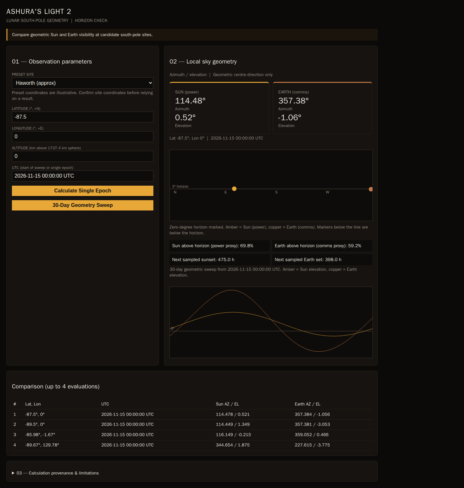
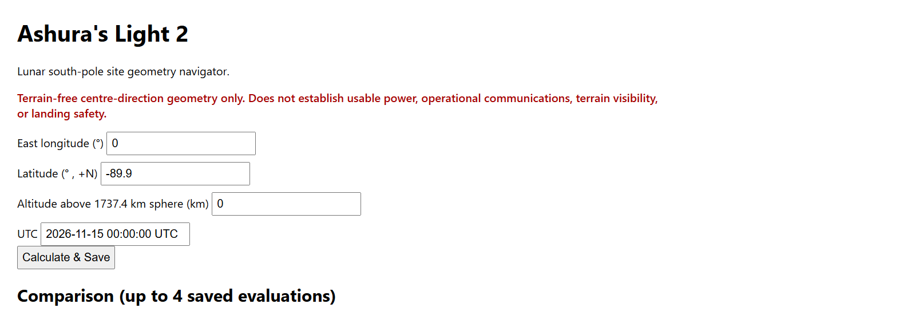
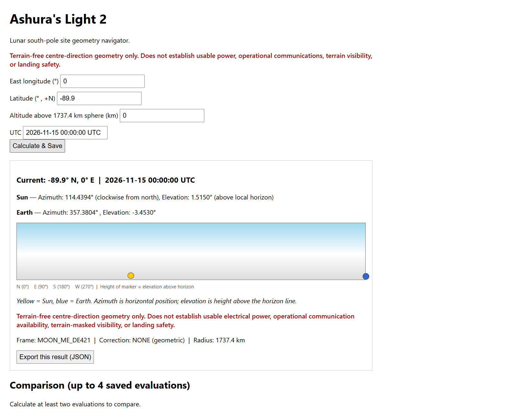
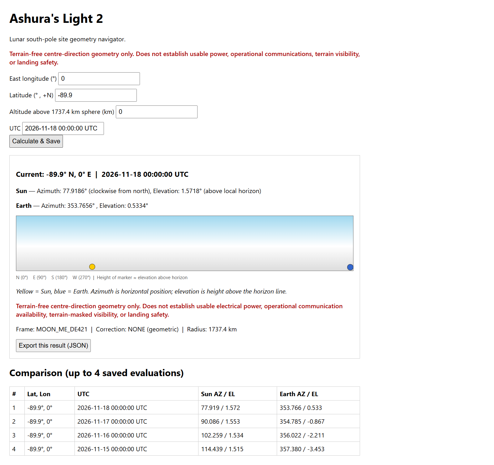
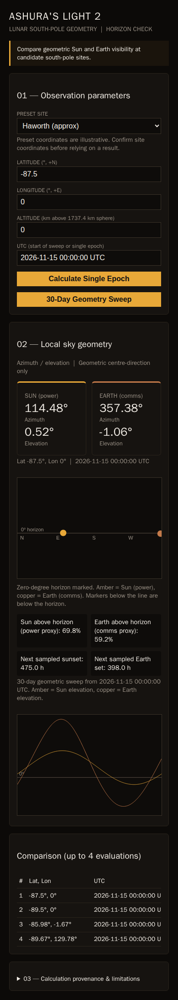

# Ashura's Light 2

The lunar south pole is a challenging place to estimate sunlight: the Sun stays close to the horizon, and small changes in location can change when it rises or sets. Those illumination windows matter when comparing landing-site candidates and planning solar-powered operations.

Ashura's Light 2 calculates the Sun's and Earth's geometric centre-direction azimuth and elevation above a local, terrain-free horizon. Its 30-day sweep plots both elevations over time and summarizes the samples above the horizon, helping users compare candidate locations and spot differences in their visibility windows.

The current model does not include local terrain or shadows. It does not predict actual surface illumination, usable power, operational communications, or landing safety.



## Run with Python

Requirements: Python 3.10 or later and an internet connection to download the kernels.

From the project folder:

```bash
python -m venv .venv
```

Activate the environment:

```bash
# macOS / Linux
source .venv/bin/activate
```

```powershell
# Windows PowerShell
.\.venv\Scripts\Activate.ps1
```

Then install dependencies, download and verify the kernels, and start the app:

```bash
python -m pip install -r requirements.txt
python scripts/bootstrap_kernels.py
python app.py
```

Open <http://127.0.0.1:5000>. Keep the app running while you use it; stop it with Ctrl+C. If you download the kernels after starting the app, stop and restart the app so it loads them.

The download command places kernels in `kernels/` by default. The app verifies the five files against [the kernel manifest](docs/KERNEL_MANIFEST.md) before calculating. It will not run calculations with missing, modified, or extra files. If you already have the verified files in another folder, set `AL2_KERNEL_DIR` to that folder before starting the app.

## Run with Docker

From the project folder, build and run:

```bash
docker build -t ashuras-light2 .
docker run --rm -p 127.0.0.1:5000:5000 ashuras-light2
```

The build needs an internet connection to download dependencies and kernels. The running container does not download anything. Open <http://127.0.0.1:5000>.

## Offline judge package

The prebuilt Docker archive is not stored in this source repository and must be provided separately. If it is included with your submission, follow the [offline judge quick start](docs/JUDGE_QUICKSTART.md) to verify, load, and run it. Do not expect a clone of this repository alone to contain the archive.

## What it does

- Calculates Sun and Earth azimuth/elevation at a site and UTC time.
- Shows a horizon plot and compares up to four single-epoch calculations.
- Samples the next 30 days hourly, plots both elevations, and reports the percentage of samples above zero degrees and the next sampled set time.
- Includes preset candidate coordinates (some marked approximate) and exports the latest single-epoch result as JSON.

The method uses the DE421 SPICE kernels, `MOON_ME_DE421` frame, geometric correction (`NONE`), and a 1737.4 km reference radius. Details and limitations are shown in the app.

## Tests

After installing dependencies and downloading kernels, run:

```bash
python -m pytest -q
```

Without kernels, kernel-dependent tests are skipped.

## Further information

- [Kernel files, download, and verification](docs/KERNEL_MANIFEST.md)
- [Docker quick start](docs/JUDGE_QUICKSTART.md)
- [Kernel third-party notice](docs/KERNEL_NOTICES.md)

## Screenshots

Product screenshots include the interface, results, comparison, and provenance views.










## License

Project code is MIT-licensed. NAIF kernels have separate terms; see [the notice](docs/KERNEL_NOTICES.md).
