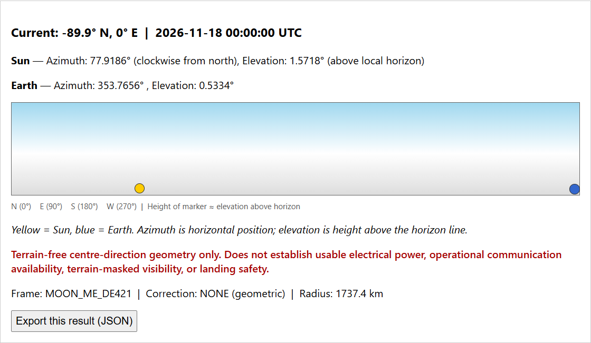

# Ashura's Light 2

Ashura's Light 2 is a local lunar south-pole geometry navigator. Given a site and UTC time, it calculates terrain-free centre-direction azimuth and elevation for the Sun and Earth using the pinned DE421 SPICE kernel stack.

## Screenshots

These screenshots were captured from the running application with the verified kernel stack described below.

| Screen | Description |
| --- | --- |
|  | Main application with example inputs |
|  | Live Sun/Earth calculations and horizon view |
|  | Four calculated UTC dates for one site |
|  | Result, provenance, limitations, and JSON export control |

## Features

- Site input: east longitude, latitude, and altitude above the 1737.4 km reference sphere.
- UTC date-time input.
- Geometric centre-direction Sun and Earth azimuth/elevation.
- Labeled N/E/S/W horizon visualization.
- Side-by-side comparison of up to four saved evaluations.
- JSON export containing inputs, outputs, frame, correction mode, and provenance.
- Explicit limitations shown with each result.

## Installation and local launch

Python 3 and the packages in `requirements.txt` are required.

```powershell
python -m venv .venv
.\.venv\Scripts\Activate.ps1
python -m pip install -r requirements.txt
```

Obtain and verify the kernels as described in [Kernel acquisition and verification](#kernel-acquisition-and-verification), then point the application at their directory and launch it:

```powershell
$env:AL2_KERNEL_DIR = (Resolve-Path .\kernels).Path
python app.py
```

Open <http://127.0.0.1:5000/>.

On macOS/Linux, activate the environment with `source .venv/bin/activate`, set `AL2_KERNEL_DIR` with `export AL2_KERNEL_DIR=./kernels`, and run `python app.py`.

The application does not calculate results unless all required kernels load successfully.

## Kernel acquisition and verification

Kernels are not included in this repository. Download the five pinned files unchanged from the official [NAIF generic kernels archive](https://naif.jpl.nasa.gov/pub/naif/generic_kernels/) into a local `kernels/` directory. The exact archive subdirectories, filenames, and expected SHA-256 values are in [docs/KERNEL_MANIFEST.md](docs/KERNEL_MANIFEST.md).

Before launching, compare each downloaded file's SHA-256 to that manifest. For example, in PowerShell:

```powershell
Get-FileHash .\kernels\* -Algorithm SHA256
```

You may instead store verified files elsewhere and set `AL2_KERNEL_DIR` to that directory. Users supply the files locally; there is no in-app kernel upload or runtime downloader.

NAIF's [SPICE use rules](https://naif.jpl.nasa.gov/naif/rules.html) permit downloading and using kernels on its server, and permit redistribution of those kernels when they have not been modified. Kernel terms are separate from this project's MIT license; verify the source terms for any kernels obtained from elsewhere.

## Example calculations

Observed live using the manifest-verified DE421 stack; site longitude 0° east, latitude 89.9° south, altitude 0 km:

| UTC | Sun AZ / EL | Earth AZ / EL |
| --- | --- | --- |
| 2026-11-15 00:00:00 UTC | 114.4394° / 1.5150° | 357.3804° / -3.4530° |
| 2026-11-16 00:00:00 UTC | 102.2594° / 1.5340° | 356.0220° / -2.2115° |

These are execution examples for the stated inputs and kernel stack, not mission-grade validation or operational predictions.

## Scientific methodology

- Ephemeris: pinned DE421 SPICE stack (file names and hashes in the kernel manifest).
- Frame: `MOON_ME_DE421`.
- Correction: `NONE` (geometric).
- Reference radius: 1737.4 km.
- Site coordinates: planetocentric east longitude and latitude; altitude measured above the reference sphere, in km.
- Local basis: radial up, east, north.
- Azimuth: clockwise from north, in degrees.
- Elevation: relative to the local horizontal plane, in degrees.
- Time input: UTC string converted to ephemeris time by SPICE.

## Limitations

The application reports terrain-free geometric centre-direction quantities only. It does not establish:

- Usable electrical power or illumination duration.
- Operational communication availability.
- Terrain-masked visibility.
- Landing safety.
- Mission-grade accuracy or suitability for navigation.

Azimuth is undefined at the exact or near-exact pole for the current local tangent-basis convention. These outputs must not be interpreted as terrain-verified or operational results.

## Deployment feasibility

This is a Flask/Python application that requires a Python-capable web-service runtime, a WSGI server, and the five kernel files available at startup. Render documents Python web services, but its default filesystem is ephemeral; preserving local files across restarts requires a paid persistent disk. A hosted instance could use that disk with verified kernels supplied by its operator and `AL2_KERNEL_DIR` set to the mounted path.

NAIF's rules allow unmodified kernels from its archive to be downloaded and used, but this application does not implement runtime acquisition or hash verification. Browser users cannot provide kernels through the UI. No host configuration, kernel provisioning, or deployment credentials are present, so this repository has not been deployed and has no deployment URL. A local demonstration is the supported path for this submission; kernels are not bundled.

Hosting references: [Render web services](https://render.com/docs/web-services) and [Render persistent disks](https://render.com/docs/disks).

## Tests

With the required kernels available:

```powershell
python -m pytest -q
```

The kernel-backed geometry suite contains three tests.

## License

The original project code is licensed under the [MIT License](LICENSE). SPICE kernels are separate data files and are not included.
