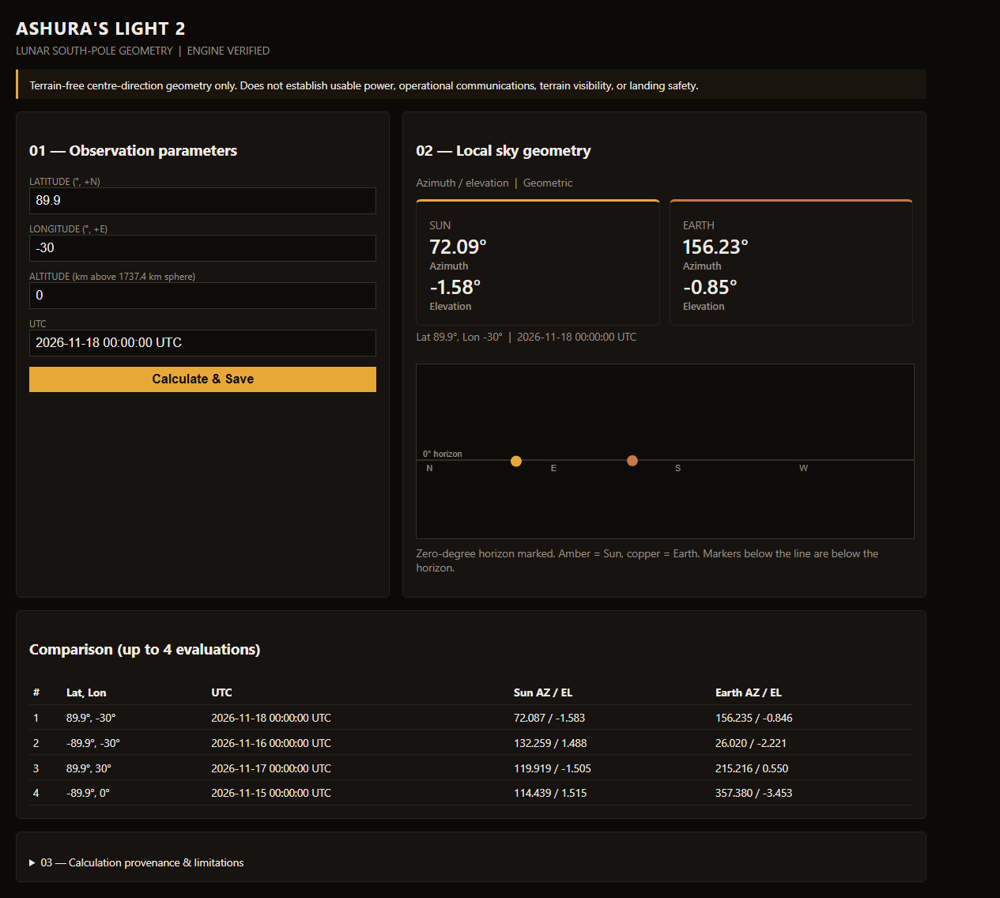
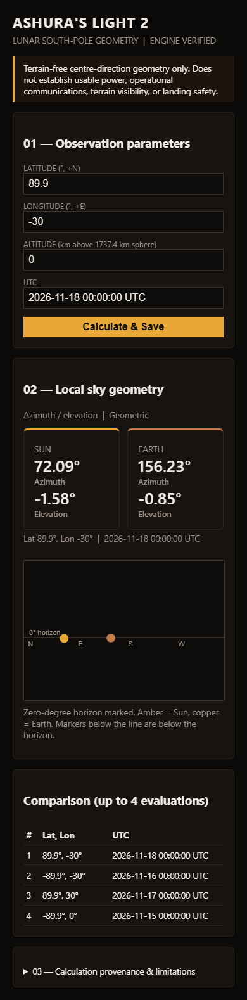

# Ashura's Light 2

Ashura's Light 2 is a lunar south-pole geometry navigator. Given a site and UTC time, it calculates terrain-free centre-direction azimuth and elevation for the Sun and Earth using the pinned DE421 SPICE kernel stack.

## Features
- Site input (signed latitude and longitude)
- UTC date-time
- Geometric centre-direction Sun and Earth AZ/EL
- Labeled horizon plot (markers below the line are below the horizon)
- Comparison of up to four saved evaluations
- JSON export with provenance
- Explicit limitations

## Screenshots




## Installation
```bash
python -m venv .venv
source .venv/bin/activate
pip install -r requirements.txt
```

## Kernel acquisition
```bash
python scripts/bootstrap_kernels.py
```
This downloads the five NAIF files listed in `docs/KERNEL_MANIFEST.md` into `kernels/`. Each download is staged in a temporary file, hash-checked, and atomically moved into place; a mismatch leaves any existing destination file untouched.

```bash
export AL2_KERNEL_DIR=kernels
python app.py
```
Open http://127.0.0.1:5000

On Windows PowerShell:
```powershell
$env:AL2_KERNEL_DIR = (Resolve-Path .\kernels).Path
python app.py
```

The application re-reads the manifest and verifies all five hashes before loading any kernel into SPICE. The kernel directory must contain exactly the five manifest-listed regular files; missing, modified, symlinked, or extra entries prevent calculations. To provide kernels yourself, place the unmodified files from the manifest in that directory. The application does not calculate with a partially loaded or unverified stack.

To acquire and launch in PowerShell:
```powershell
python scripts\bootstrap_kernels.py
$env:AL2_KERNEL_DIR = (Resolve-Path .\kernels).Path
python .\app.py
```

## Docker
```bash
docker build -t al2 .
docker run -p 127.0.0.1:5000:5000 al2
```
The image downloads and verifies kernels at build time. The application listens on `0.0.0.0:5000`; the loopback-only host binding keeps the published port local.

## Offline judge distribution
The prebuilt archive is `dist/ashura-light2-judge.tar`; verify it with `dist/SHA256SUMS`. See [docs/JUDGE_QUICKSTART.md](docs/JUDGE_QUICKSTART.md) for the load and launch procedure. The distribution includes the verified kernels; no kernel download or NAIF network access is needed at runtime. Third-party terms are documented separately in [docs/KERNEL_NOTICES.md](docs/KERNEL_NOTICES.md).

## Scientific methodology
- Frame: MOON_ME_DE421
- Correction: NONE (geometric)
- Reference radius: 1737.4 km
- Azimuth: clockwise from north
- Elevation: relative to local horizontal plane

## Example calculation
At longitude 0°, latitude -89.9°, altitude 0 km, and `2026-11-15 00:00:00 UTC`:

| Body | Azimuth | Elevation |
|---|---:|---:|
| Sun | 114.4394° | +1.5150° |
| Earth | 357.3804° | -3.4530° |

These are geometric centre-direction results; the Earth is below the zero-degree horizon in this example.

## Limitations
Terrain-free centre-direction geometry only. Does not establish usable electrical power, operational communication availability, terrain-masked visibility, or landing safety.

## Tests
```bash
pytest tests/
```

## License
MIT. Kernels are separate and subject to NAIF redistribution terms.
